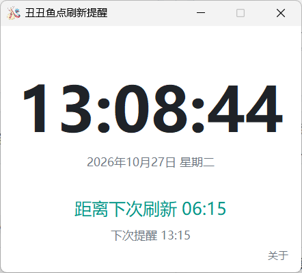
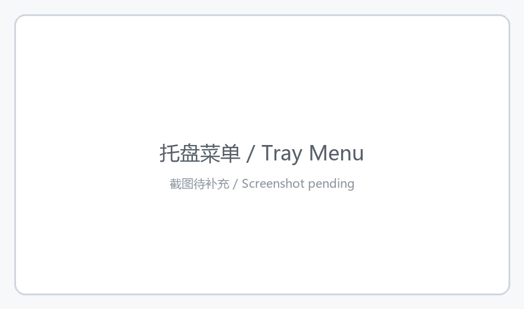

# 丑丑鱼点刷新提醒工具 / Fish Spot Refresh Reminder

**固定周期、全天循环的丑丑鱼点刷新提醒工具，静默驻留系统托盘，到点提醒不打断游戏节奏。**
**A fixed-interval refresh reminder that lives quietly in your system tray and never breaks your fishing rhythm.**

[](../../releases/latest)
[](#)
[](#)
[](LICENSE)
[](../../commits)

如果这个项目对你有帮助，欢迎点个 ⭐ Star 支持一下。
If this project saves you a few missed refreshes, a ⭐ Star is appreciated.

---

## 📖 项目介绍 / Introduction

**中文**

PokeMMO 丰源地区 119 号路、神奥地区天冠山的丑丑鱼点按固定周期刷新，靠手感掐时间总会差那么几十秒，切出去看时钟又会打断钓鱼节奏。这个工具把计时交给后台：设好周期，它就在托盘里安静地数着，到点弹出系统通知并播放提示音。

整个软件只有一个 exe：主界面实时显示当前时间与距离下次刷新的倒计时，右上角可查看版本与联系方式，关掉窗口就收回托盘继续计时。没有安装向导、不写注册表。周期算法按绝对时间取整，跨天自动衔接；只要周期分钟数能整除 1440（单日总分钟数），提醒时刻就永远不会逐日漂移。

**English**

Fish spots on Route 119 in PokeMMO's Hoenn region and in Mt. Coronet in Sinnoh refresh on a fixed interval. Timing it by feel always lands a few seconds off, and alt-tabbing to check the clock breaks your rhythm. This tool takes the timing off your hands: set the interval once, and it counts quietly in the tray, then raises a system notification and plays a sound cue at exactly the right moment.

The whole thing is a single `.exe`: the main window shows the current time and a live countdown to the next refresh, the corner holds version and contact info, and closing the window drops it back into the tray. No installer, no registry writes. The scheduler rounds against absolute time, so cycles roll over midnight seamlessly. As long as the interval divides 1440 evenly (minutes in a day), reminder times never drift from one day to the next.

## ✨ 功能特性 / Features

**中文**

- ⏱️ **精准周期算法** — 固定周期全天循环，跨天无缝衔接；周期能整除 1440 时，每天的提醒时刻完全一致，不存在逐日偏移。
- 🕒 **主界面倒计时** — 大字显示当前时间，下方实时倒数到下次刷新，一眼看清还要等多久。
- 🖥️ **系统托盘驻留** — 关掉主窗口即收回托盘，不占任务栏空间、计时不中断，适合长期后台挂着。
- 🔔 **双通道提醒** — 右下角系统通知 + 提示音同时触发，通知被系统拦截时还有声音兜底。
- 👀 **状态可见** — 鼠标悬停托盘图标，即可看到下次提醒的具体时刻。
- 🎛️ **灵活开关** — 托盘右键菜单可随时暂停/恢复提醒、单独关闭提示音，或一键退出。
- 📦 **单文件绿色版** — 免安装，下载双击即用，目标机器无需 Python 环境。
- 🤖 **云端自动构建** — 推送版本标签后由 GitHub Actions 自动打包并发布 Release。
- 🪶 **低资源占用** — 单进程常驻约 30–50 MB，空闲时 CPU 接近 0。

**English**

- ⏱️ **Deterministic scheduler** — A fixed interval loops around the clock and rolls over midnight seamlessly. When the interval divides 1440, every day's reminder times are identical — zero drift.
- 🕒 **Live countdown** — A large clock with a real-time countdown to the next refresh, so you always know how long is left.
- 🖥️ **Tray-resident** — Closing the window drops it into the tray. No taskbar footprint, the countdown keeps running; built to sit in the background for weeks.
- 🔔 **Two-channel alerts** — A system notification in the bottom-right corner plus a sound cue, so a blocked notification still leaves you an audible heads-up.
- 👀 **Next run at a glance** — Hover the tray icon to see exactly when the next reminder is due.
- 🎛️ **On-demand control** — The tray menu pauses or resumes reminders, mutes the sound, fires a test alert, and exits cleanly.
- 📦 **Single-file portable** — No installer, no Python on the target machine. Download, double-click, done.
- 🤖 **CI-built releases** — Pushing a version tag makes GitHub Actions build and publish the release automatically.
- 🪶 **Lightweight** — One process, roughly 30–50 MB resident, near-zero CPU when idle.

## 🚀 快速开始 / Quick Start

**中文**

1. 打开 [Releases](../../releases/latest) 页面，下载最新版的 `PokeMMO-Feebas-Reminder.exe`。
2. 双击运行，托盘出现美纳斯图标即启动成功，无需安装。
3. 右键托盘图标可开关提醒、暂停计时，关闭主窗口则收回托盘继续后台运行。

> 首次运行 Windows SmartScreen 可能提示「已保护你的电脑」，点「更多信息」→「仍要运行」即可（exe 未做代码签名）。

**English**

1. Open the [Releases](../../releases/latest) page and download the latest `PokeMMO-Feebas-Reminder.exe`.
2. Double-click it — a Milotic icon appears in the tray and it is running. No installation.
3. Right-click the tray icon to pause or resume reminders; closing the main window drops it into the tray and keeps counting.

> Windows SmartScreen may warn "Windows protected your PC" on first launch. Click **More info** → **Run anyway** — the binary is simply not code-signed.

## 🖼️ 界面预览 / Screenshots

**中文**

> 以下为占位图，把实际截图放进 `docs/images/` 并保持同名即可替换。

| 主界面 / Main Window | 托盘菜单 / Tray Menu |
| :---: | :---: |
|  |  |
| 当前时间 + 下次刷新倒计时 | 右键菜单：显示主窗口、开关提醒、提示音、退出 |

**English**

> Placeholders — drop real screenshots into `docs/images/` using the same filenames.

| Main Window | Tray Menu |
| :---: | :---: |
|  |  |
| Current time + countdown to the next refresh | Right-click menu: show window, toggle, mute, quit |

## ⚙️ 本地运行与构建 / Build from Source

**中文**

**环境要求**：Windows 10/11，Python 3.9 及以上。

**前置注意**：安装 Python 时务必勾选 `tcl/tk and IDLE` 组件，否则 `import tkinter` 会失败——主界面依赖它。

```bash
# 安装依赖（仅 pystray + Pillow，tkinter / winsound 为标准库）
pip install -r requirements.txt

# 本地运行
python reminder.py               # 带控制台，便于查看报错
pythonw reminder.py              # 无控制台窗口，日常使用
python reminder.py --selfcheck   # 只跑周期算法自检，不启动界面
```

**手动打包**（单文件、无控制台黑框）：

```bash
python -m PyInstaller --onefile --windowed --name "丑丑鱼点刷新提醒工具" reminder.py
```

也可以直接双击 `build_exe.bat`，脚本会自动检查 Python 与 tkinter、安装依赖并完成打包。

**产物位置**：`dist\丑丑鱼点刷新提醒工具.exe`，可直接拷到任意 Windows 机器运行。

**调整周期**：修改 `reminder.py` 顶部的 `PERIOD_MIN`（默认 45 分钟）后重新打包。请选择能整除 1440 的值（30 / 45 / 60 / 90 / 120），否则提醒时刻会逐日偏移，原因见 [常见问题](#-常见问题--faq)。

**English**

**Requirements**: Windows 10/11, Python 3.9+.

**Before you start**: make sure `tcl/tk and IDLE` is checked during the Python install — otherwise `import tkinter` fails and the main window breaks.

```bash
# Dependencies (just pystray + Pillow; tkinter and winsound ship with Python)
pip install -r requirements.txt

# Run locally
python reminder.py               # with console, useful for tracebacks
pythonw reminder.py              # no console window, for daily use
python reminder.py --selfcheck   # assert-based scheduler check only
```

**Build a single-file, console-free exe**:

```bash
python -m PyInstaller --onefile --windowed --name "丑丑鱼点刷新提醒工具" reminder.py
```

Or just double-click `build_exe.bat` — it verifies Python and tkinter, installs dependencies, and builds for you.

**Output**: `dist\丑丑鱼点刷新提醒工具.exe`, portable to any Windows machine.

**Tuning the interval**: edit `PERIOD_MIN` at the top of `reminder.py` (default: 45 minutes) and rebuild. Pick a value that divides 1440 (30 / 45 / 60 / 90 / 120); anything else makes reminder times drift — see the [FAQ](#-常见问题--faq) for why.

## 📦 自动发布流程 / Auto Release

**中文**

工作流位于 `.github/workflows/build-release.yml`：**只有推送形如 `v*` 的标签才会触发**，普通提交和分支推送不会构建。

```bash
git tag -a v1.1.0 -m "v1.1.0"
git push origin v1.1.0
```

推送后 Actions 自动执行：检出代码 → 配置 Python 3.11 → 安装依赖 → PyInstaller 打包 → 创建同名 Release 并上传附件（约 2–4 分钟）。发布说明由固定模板加自动生成的提交记录组成，发布后仍可手动补充。

> **附件名说明**：GitHub 的 Release 附件名只支持 ASCII，中文文件名会被平台静默改写成 `default.exe`。因此 CI 会把产物另存为 `PokeMMO-Feebas-Reminder.exe` 再上传；本地打包的产物仍是中文名。

**English**

The workflow lives in `.github/workflows/build-release.yml` and **only runs on `v*` tags** — regular commits and branch pushes never trigger a build.

```bash
git tag -a v1.1.0 -m "v1.1.0"
git push origin v1.1.0
```

Actions then checks out the code, sets up Python 3.11, installs dependencies, builds with PyInstaller, and creates a Release with the exe attached (roughly 2–4 minutes). Release notes combine a fixed template with auto-generated commit history and can be edited afterwards.

> **About the asset name**: GitHub only accepts ASCII release asset names — a Chinese filename is silently rewritten to `default.exe`. CI therefore re-saves the binary as `PokeMMO-Feebas-Reminder.exe` before uploading. Locally built binaries keep the Chinese name.

## ❓ 常见问题 / FAQ

**中文**

**Q：运行或打包时提示 `No module named 'tkinter'`**
A：安装 Python 时没勾 `tcl/tk and IDLE`。重新运行安装包 → `Modify` → 勾选该组件 → 安装完成后重新打包。用 `build_exe.bat` 打包会提前检查并给出提示。

**Q：有提示音，但收不到系统通知**
A：多半是 Windows 专注助手或勿扰模式拦截了通知。到「设置 → 系统 → 通知」里允许该程序通知即可；提示音不受影响。

**Q：什么情况下提醒时间会逐日偏移**
A：周期分钟数不能整除 1440 时。一天是 1440 分钟，只有能整除它的周期（30 / 45 / 60 / 90 / 120 …）才能让周期相位每天重合；改成 50 分钟这类值，每次循环都会累积余数，提醒时刻会一天天往后挪。程序仍可运行，只是不再是固定的每日时刻表。

**Q：杀毒软件报毒或直接删掉 exe**
A：PyInstaller 打包的未签名 exe 常被启发式引擎误判。把文件加入白名单后重试，或从源码自行打包。

**English**

**Q: `No module named 'tkinter'` when running or building**
A: Python was installed without `tcl/tk and IDLE`. Re-run the installer → `Modify` → check that component → reinstall → rebuild. `build_exe.bat` checks for this up front and tells you.

**Q: Sound plays, but there is no system notification**
A: Windows Focus Assist / Do Not Disturb is usually swallowing it. Allow the app under Settings → System → Notifications. The sound is unaffected.

**Q: When do reminder times drift from day to day?**
A: When the interval does not divide 1440. A day has 1440 minutes, and only its divisors (30 / 45 / 60 / 90 / 120 …) keep the cycle phase aligned every day. Set it to something like 50 and the remainder accumulates, pushing each cycle a little later. The app still runs — it just stops being a fixed daily timetable.

**Q: Antivirus flags or deletes the exe**
A: Unsigned PyInstaller binaries are frequently false-positived by heuristics. Whitelist the file, or build it yourself from source.

## 🤝 贡献指南 / Contributing

**中文**

欢迎提交 Issue 反馈问题或提出建议，也欢迎直接提 PR。请保持改动聚焦——一个 PR 解决一个问题，并在描述里说明动机与影响范围。提交前建议先本地跑一次 `python reminder.py --selfcheck`。

**English**

Issues and pull requests are both welcome. Keep changes focused — one problem per PR — and explain the motivation and blast radius in the description. Please run `python reminder.py --selfcheck` locally before submitting.

## 📄 开源协议 / License

**中文**

本项目基于 [MIT License](LICENSE) 开源，Copyright © 2026 [xihuatime](https://github.com/xihuatime)。

**English**

Released under the [MIT License](LICENSE). Copyright © 2026 [xihuatime](https://github.com/xihuatime).

## 📬 联系作者 / Contact

**中文**

- 提交 [Issue](../../issues)（推荐，方便其他人检索到同样的答案）
- 邮箱：`<1371365690@qq.com>`

**English**

- Open an [Issue](../../issues) — preferred, so others can find the answer too
- Email: `<1371365690@qq.com>`

---

<sub>本项目与 PokeMMO 官方无关，仅为玩家自制的辅助计时工具。 / Not affiliated with the PokeMMO team — a fan-made timing utility.</sub>
